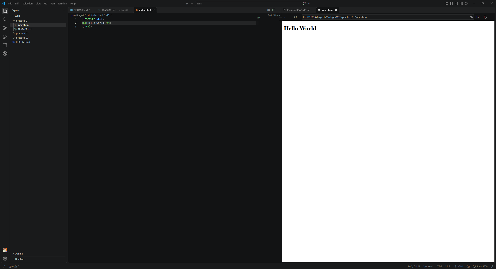
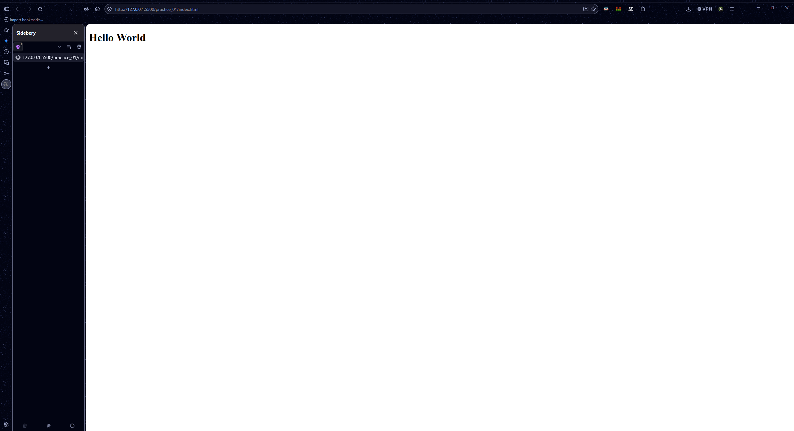

# Практична 1

Встановити і налаштувати середовище розробки Visual Studio Code (або інше не свій вибір).
Встановити розширення Live Server (або аналог).
Створити новий (дефолтний) html документ.

В результаті завдання - закріпити скріншот

# Виконання роботи

1. Знімок екрану середовища розробки Visual Studio Code з html документом відкритим в інтегрованому браузері

2. Знімок екрану з html документом відкритим з розширенням Live Server

