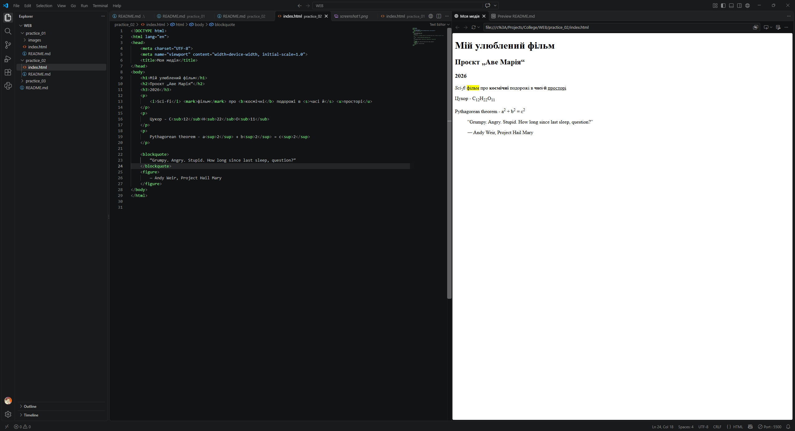

# Практична 1

Тема
Форматування тексту за допомогою тегів HTML
Мета роботи
Навчитися використовувати теги форматування тексту (заголовки, абзаци, виділення, списки, цитати) для створення структурованої веб-сторінки.Теоretичні відомості (коротко)

    <h1>–<h6> — заголовки різних рівнів
    
 — абзац
    <b> / <strong> — жирний текст (семантично важливий текст)
    <i> / <em> — курсив (виділення з наголосом)
    <u> — підкреслений текст
    <s> / <del> — закреслений текст
    <mark> — виділення маркером
     /  — нижній/верхній індекс
      — перенесення рядка
    
 — горизонтальна лінія
    <blockquote> — цитата
    <ul>, <ol>, <li> — списки (маркований, нумерований)
    <pre>, <code> — форматований/програмний текст

Хід роботи:

    Створіть html-файл practice.html з базовою структурою (`<!DOCTYPE html>, <html>, <head>, <body>`).
    Додайте заголовок сторінки `<title>` та три заголовки різних рівнів (`<h1>, <h2>, <h3>`) на тему "Мій улюблений фільм/книга/хобі" (на вибір).
    Напишіть два абзаци тексту про обрану тему. В одному абзаці виділіть частину тексту жирним (`<strong>`), в іншому — курсивом (`<em>`).
    Додайте речення, в якому одночасно використано підкреслення, закреслений текст і виділення маркером.
    Створіть хімічну формулу (наприклад, H₂O) за допомогою `` та математичний вираз зі степенем (наприклад, x²) за допомогою ``.
    Вставте кілька цитат відомої людини, використовуючи `<blockquote>` з описом про людину використовуючи теги figure/figurecaption.

# Виконання роботи

1. Знімок екрану середовища розробки Visual Studio Code з html документом відкритим в інтегрованому браузері

