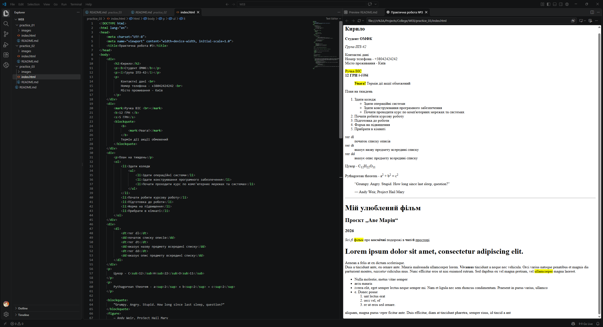

# Практична 3

Тема
Форматування тексту чистими засобами HTML
Хід роботи

Створіть файл practice2.html з базовою структурою документа. У `<head>` додайте `<title>` — "Практична робота №3".
Оформіть "візитку" — текстовий блок про себе (2–3 речення), де:

    ім'я оформлено як заголовок <h2>;
    одна фраза виділена жирним (<strong>);
    одна фраза виділена курсивом (<em>);
    контактні дані (наприклад, місто проживання) розташовані з новим рядком через  .

Напишіть абзац-опис товару (будь-якого), у якому:

    назву товару виділіть тегом <mark>;
    ціну — тегом <strong>;
    застарілу (стару) ціну — тегом <s> або <del>.

Створіть вкладені списки:

    нумерований список <ol> "План на тиждень" (5 пунктів);
    у одному з пунктів вкладіть маркований підсписок <ul> (2–3 елементи).

Оформіть "попередження" (наприклад, "Увага! Термін дії акції обмежений") за допомогою тегу `<blockquote>`, виділивши ключове слово тегами `<strong>` і `<mark>`.
Створіть словник термінів (3 слова за вашою темою) за допомогою тегів `<dl>`, `<dt>`, `<dd>`.
Додайте хімічну формулу (наприклад, H₂SO₄) через `` та математичний вираз зі степенем (наприклад, 2⁵) через ``.
Вставте цитату відомої людини за допомогою `<blockquote>` та вкажіть автора тегом ``.
Додайте горизонтальну лінію `
` для розділення розділів сторінки та перевірте коректність переносів рядків ` ` у тексті.
Оформіть невелике "оголошення" (не менше 5 речень) на будь-яку тему, використовуючи щонайменше 8 різних вивчених тегів форматування одночасно (заголовки, виділення, списки, цитата тощо).

# Виконання роботи

1. Знімок екрану середовища розробки Visual Studio Code з html документом відкритим в інтегрованому браузері

