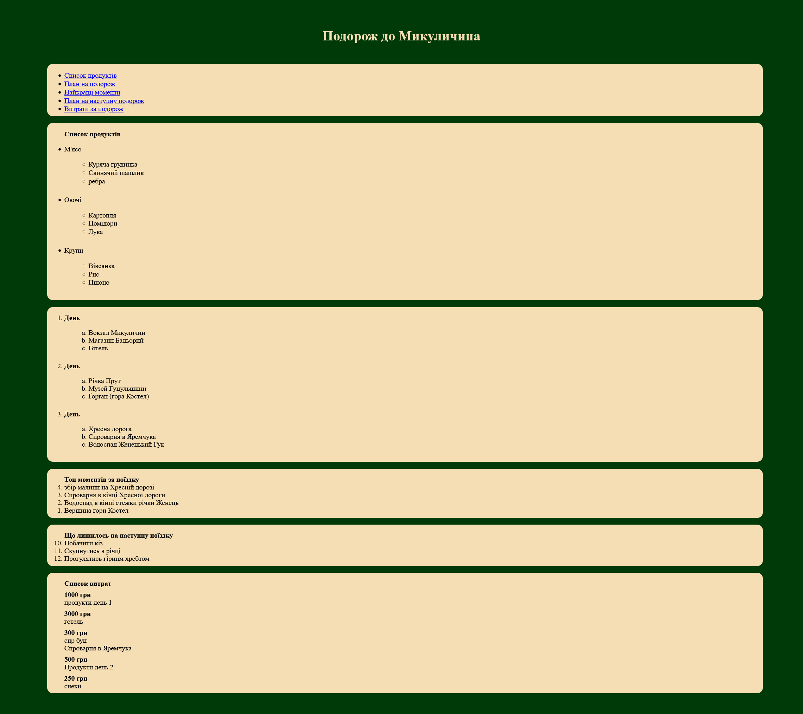

# Практична 4

Тема
«Сторінка мандрівника: план поїздки до Карпат»
Хід роботи

Створіть файл trip.html зі сторінкою-планом триденної поїздки. Використовуйте тільки HTML (без CSS), крім бонусного завдання.
Структура сторінки

    <h1> з назвою поїздки.
    Меню-якорі у вигляді <ul> з посиланнями на розділи сторінки (<a href="#route">).

 (маркований список)

    Мінімум 3 категорії: , , .
    Кожна категорія містить вкладений <ul> мінімум із 3 пунктів.

 (нумерований список)

    Зовнішній <ol>: День 1, День 2, День 3.
    Всередині кожного дня вкладений <ol> з точками маршруту за часом.
    Для вкладеного списку використайте type="a" або type="I".
    Нумерований список у зворотному порядку (reversed) від 5-го місця до 1-го.
    Для одного пункту задайте атрибут value, наприклад, щоб пропустити номер.
    Другий список: start="10", наприклад «Пункти, які лишилися на наступну поїздку».

 (список визначень)

    <dl> мінімум із 5 термінів: <dt> (термін) та <dd> (пояснення).
    Хоча б для одного терміна зробіть два <dd>.
    Список витрат (<ul>), де кожен пункт містить суму.

# Виконання роботи

1. Знімок екрану середовища розробки Visual Studio Code з html документом відкритим в інтегрованому браузері

